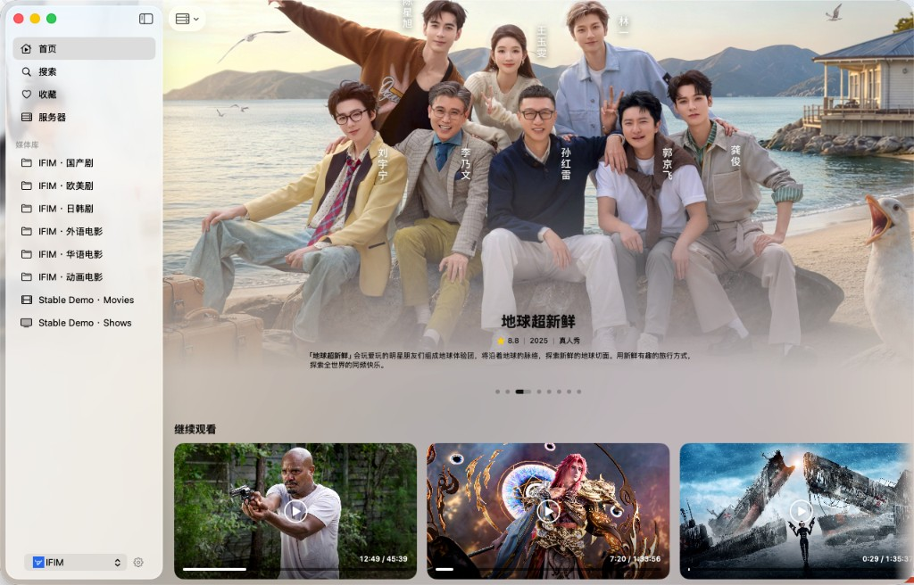
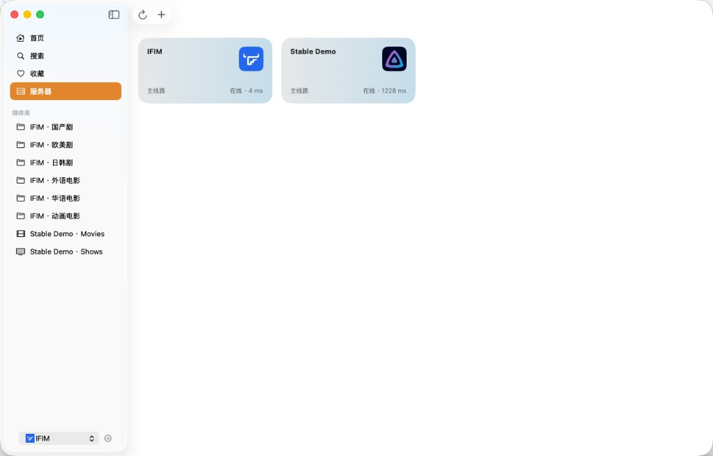
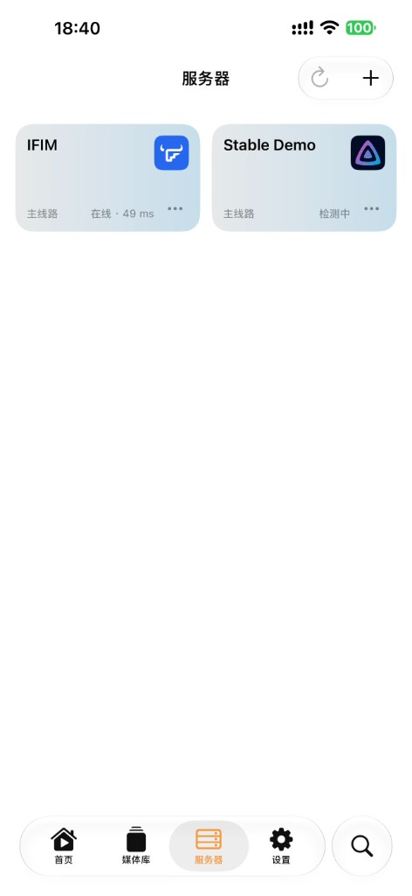
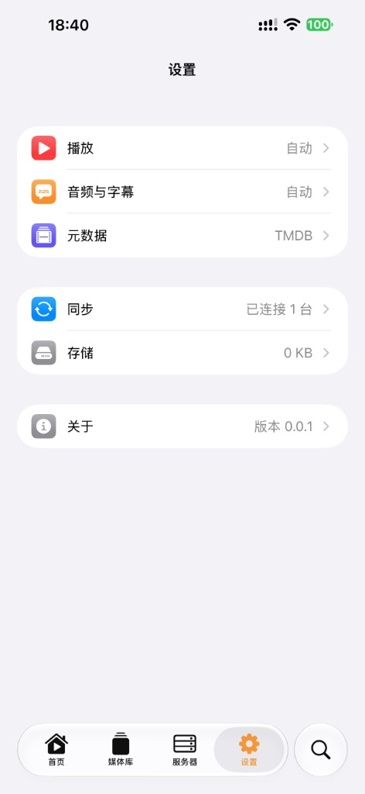
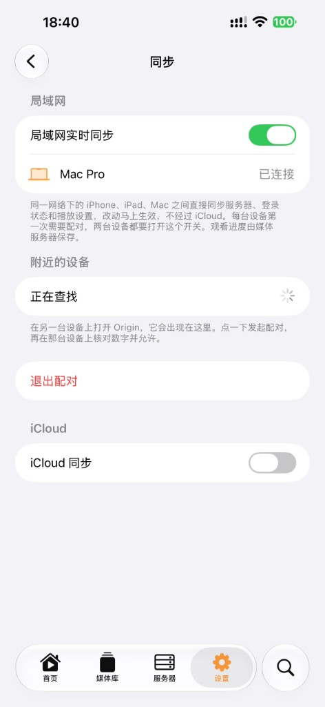

# Origin

在 iPhone、iPad 和 Mac 上连接自己的媒体服务器，浏览片库并播放。支持 Jellyfin、Emby、Plex 和飞牛影视。

观看进度、已看和收藏由媒体服务器保存。Origin 自己保管的是服务器列表、登录状态和播放设置。

## 功能

- 局域网里可以发现飞牛影视和 Plex。Jellyfin 与 Emby 需要手动填写地址。
- 服务器页列出已添加的服务器。每张卡片显示当前线路、在线状态和延迟。点一张卡片就切换到这台服务器。
- 每台服务器可以单独关掉「在首页和媒体库显示」。关掉后，它不出现在首页、媒体库和搜索里。一台连不上或被关掉，不影响其他服务器。
- 首页同时展示打开了显示的服务器。
- 播放内核可以自动选择：系统能播的交给系统播放器，MKV、DTS、ASS 等交给 FFmpeg。也可以固定用其中一种。
- 可以记住播放位置、自动播下一集，并设置倍速、快进快退、音轨和字幕。FFmpeg 内核可以调整字幕字号、颜色、底边距和半透明背景。
- 影片信息可以用 TMDB 补充 Logo、预告片、标语和演员头像。
- 影片可以下载到本机离线看。下载的文件不参与同步。
- 服务器可以添加备用线路。也可以给服务器加上本机认证，打开前用 Face ID 或密码确认。
- 设置按播放、音频与字幕、元数据、同步、存储、关于分组。还没有添加服务器时也可以进入设置。









## 同步

同一网络下的 iPhone、iPad、Mac 可以打开「局域网实时同步」。服务器、登录状态和播放设置的改动会马上送到其他设备，不经过 iCloud。每台设备第一次要配对：两台都打开这个开关，在「附近的设备」里点对方的名字，两边核对同一组 6 位数字后允许。退出配对后，这台设备离开同步组，其他设备之间照常同步。

已配对并且当前连着的设备之间可以接着播放。播放器里选「在其他设备上播放」，对方从当前这一秒继续，本机停止。对方需要有同一台服务器。iPhone 和 iPad 要开着 Origin 才能收到。

观看进度、已看和收藏仍由媒体服务器保存。



打开 iCloud 同步后，同一 Apple 账号下的设备也会同步服务器、登录令牌和播放设置。各设备仍各自选择当前服务器。没有 iCloud 键值存储权限时，同步改走 iCloud 钥匙串。系统设置里需要打开 iCloud 钥匙串，服务器和播放设置才会到其他设备。

## 下载

每次推送到 main，GitHub Actions 会编译一次，结果放在 Releases 的「最新构建」里。推送 `v` 开头的标签时发正式版。

- iPhone / iPad：`Origin-iOS.ipa` 没有签名，用爱思助手、Sideloadly 或 AltStore 签名安装。
- Mac：`Origin-macOS.zip` 是通用版，Intel 和 Apple 芯片都能用。解压后拖进「应用程序」。第一次打开如果被拦，到「系统设置 → 隐私与安全性」点「仍要打开」。

本机可以用 `scripts/ci-build.sh` 打出同样的包，放在 `build/dist`。

## 环境

- Xcode，以及 iOS 26、macOS 26 SDK
- [XcodeGen](https://github.com/yonaskolb/XcodeGen)
- 网络。首次执行会克隆 KSPlayer 2.3.4 和 FFmpegKit 6.1.4

## 编译

```sh
scripts/bootstrap.sh
open Origin.xcodeproj
```

工程文件由 `project.yml` 生成，不放进仓库。依赖在 `Vendor/`，同样不放进仓库。对 KSPlayer 的修改放在 `patches/KSPlayer.patch`，`bootstrap.sh` 会自动打上。

TMDB 的 Read Access Token 写在 `Config/Secrets.xcconfig`。这个文件被 git 忽略。没有它也能编译和播放，只是不会去拉 TMDB 的补充信息。示例在 `Config/Secrets.example.xcconfig`。

Xcode 里运行 Origin（iPhone / iPad）或 OriginMac。

## 许可

播放使用 [KSPlayer](https://github.com/kingslay/KSPlayer) 和 FFmpeg，二者为 GPL-3.0。本仓库源码同样按 GPL-3.0 提供。

影片资料来自 TMDB。Origin 使用 TMDB API，但没有获得 TMDB 的认可或认证。

## 支持作者

Origin 免费使用。如果它帮你看完了一部片，可以用微信扫下面的码支持作者。


